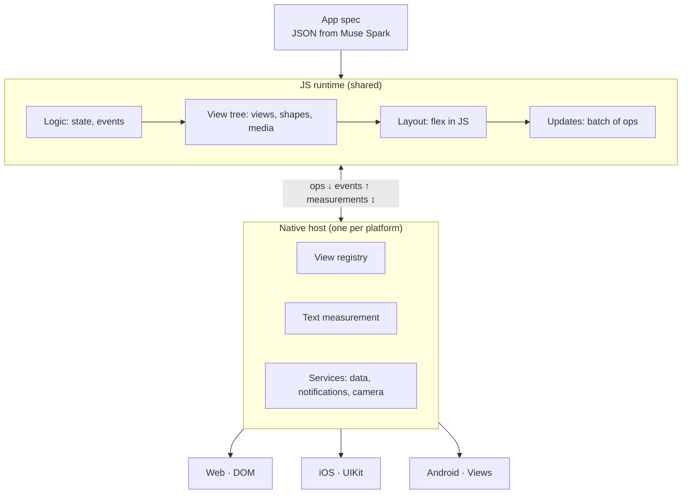

# Jig

> Describe an app, get a native one in seconds, with storage, reminders and a shared data layer built in. Muse Spark composes it from trusted components: no code to debug, nothing to deploy.

In a workshop, a jig is a tool you build for one specific job. **Jig** is one canvas for the small personal tools you describe in words.

Built for the [Meta Global AI Developer Hackathon](https://cerebralvalley.ai/e/meta-ai-developer-hackathon) (Oct 26 – Nov 4, 2026), Indie track, theme "Build for Your World".

## The problem

Everyone has needs that no app in the store fits exactly: a medication log for a parent, a kid's chore chart, a tracker for one oddly specific habit. Vibe-coding tools can generate such apps, but you get loose code: it breaks on the next edit, does nothing while closed, and keeps its data to itself.

## The idea: every app is data, not code

- You describe what you need, and **Muse Spark** composes a declarative spec: screens, components, a data schema and actions.
- The spec is validated against a schema, and the container renders it with each platform's native components. This is backend-driven UI, with the model as the backend.
- An app can't run arbitrary code, and edits apply instantly.
- Every app gets the container's services for free: storage, background jobs, notifications and a shared personal data store (with the user's permission).

Generating an app is the easy part; what only a container can offer is a **data store shared between apps** and **apps that keep acting while closed** (reminders, scheduled check-ins).

### How it differs from related work

- **[A2UI](https://a2ui.org/introduction/what-is-a2ui/)** standardizes "UI as data from a trusted component catalog". Jig shares that premise; its novelty is what sits on top of the rendering: per-app typed data, a shared data layer, background jobs, and a model loop that generates, edits and repairs specs.
- **Meta Pocket**, **GitHub Spark** and assistant canvases generate small apps, but as code on a managed runtime or a web view. Jig apps are specs rendered natively, so they can't break on edit and they share one data layer.

## Meta models

| Model | Role |
| --- | --- |
| **Muse Spark** | Generates and edits specs with structured outputs, and repairs specs that fail validation. |
| **Muse Image** | Draws app icons. |
| **SAM 3.1** | Segments and counts objects in photos, e.g. a photo of a pantry shelf becomes an inventory. |

The Meta Model API is OpenAI-SDK compatible: only the key and base URL change.

## Repository

| Path | What |
| --- | --- |
| `core/` | The shared runtime in TypeScript: spec, expressions, signals, view tree, flex layout, bridge ops. Bundles to one file (`core/dist/jig-core.js`) for the web, JavaScriptCore (iOS) and QuickJS (Android). `core/native/host.js` is the glue both native hosts share. |
| `web/` | The web host (DOM renderer and text measurement) and the playground: the shell on a phone frame, live spec editing of the open app, ops and frame inspector. |
| `specs/` | `shell.json`, the container's own UI (app list and builder), plus demo app specs (water tracker, chore chart, medication log) and `showcase.json`, a parity check that uses every primitive. The demo specs seed the shell's app list and serve as test fixtures. |
| `ios/` | The UIKit host: runs `jig-core.js` in JavaScriptCore and applies its ops to UIKit views. |
| `android/` | The Android host: runs `jig-core.js` in QuickJS and applies its ops to Android Views. |

```bash
npm install
npm run dev      # playground at http://localhost:5173
npm test         # core tests in Node with a fake measurer
npm run build    # core bundle + web build
npm run build:native   # core bundle, native glue and demo specs copied into the iOS and Android apps
```

The iOS and Android apps load `jig-core.js` and the demo specs from their bundles, so run `npm run build:native` before building them (and after changing `core/` or `specs/`). Then open `ios/Jig/Jig.xcodeproj` in Xcode, or build `android/Jig` with Gradle.

## Architecture

All logic lives in JS; each native host is a thin renderer. React Native and Lynx work the same way.



### The loop

Native sends an event → actions update state → bindings update specific nodes (a diff only for conditionals and lists) → incremental layout → native receives one batch of ops with frames.

### Spec format

A spec has `data` (typed and persisted), `state` (transient UI state), `screens`, optional `components` and a `theme`. Each node is `{type, style, children, ...props}`. Strings may contain `{{expr}}` bindings in a small, safe JS-like expression language: no assignment, no method calls, no prototype access, only built-in functions (`filter`, `count`, `sum`, `sort`, `formatDate`, `addDays`, `arc`, ...).

```json
{
  "type": "row", "each": "chores", "as": "chore",
  "onTap": { "toggle": "chore.done" },
  "children": [
    { "type": "check", "checked": "{{chore.done}}" },
    { "type": "text", "value": "{{chore.name}}", "style": { "grow": 1 } }
  ]
}
```

- **Primitives:** `column`, `row`, `overlay`, `scroll`, `list`, `text`, `button`, `textfield`, `toggle`, `shape`, `image`, `spacer`, `divider`.
- **Built-in composites** (written in the spec format itself): `card`, `progress`, `ring`, `check`.
- **Structure:** `if`, `each` / `as` / `key`, `bind` for two-way control values.
- **Actions:** `set`, `toggle`, `push`, `remove`, `navigate` (with params), `back`, `if` / `then` / `else`. Actions run in order, and each sees the state the previous one wrote.
- **Capabilities:** an app declares `"capabilities": ["clock"]` for what it uses beyond state and data. `clock` is a live value, the epoch milliseconds ticking once a second, so `{{formatDate(clock, 'HH:mm')}}` stays current while only the bindings that read it re-run. `location` (`{lat, lon, accuracy}`, coarse) and `heading` (`{degrees, accuracy}`) are live values too: they start on first read, stream from the host, and stay null until the first fix. `slider` and `timePicker` are native controls with two-way `bind` and `onChange`. Async actions answer later through `then` with the result as `value` (or `else` with `error`); the shell asks the user the first time each app uses one that needs permission.
- **Motion:**
  - `navigate` slides the new screen in from the right, and `back` slides it out; `"transition": "fade"` or `"none"` changes that per navigation. The iOS edge swipe and Android's predictive back gesture are interactive: the screen follows the finger over a snapshot of the previous one, and pops or springs back on release.
  - `style.transition` (milliseconds, or `{"duration", "easing"}` with `ease`, `linear`, `easeIn`, `easeOut` or `spring`) animates a node between values: its frame, opacity, colors and shape trim. A node that appears in an existing list fades in, and one that is removed fades out while its siblings move into its place.
  - Shapes take `trimStart` and `trimEnd` (0–1) to draw part of their stroke, which is how `ring` sweeps smoothly. `ring` and `progress` animate by default (`"animate": false` turns it off).
  - Hosts skip animations when the system asks for reduced motion.
- **Design tokens:** theme colors (`accent`, `muted`, `surface`, ...) and type variants (`largeTitle`, `title`, `headline`, `body`, `callout`, `caption`) are resolved in the core, so every platform renders the same numbers. Each token has a dark value; hosts follow the system appearance with `runtime.setColorScheme`, and a spec can override either set (`theme`, `darkTheme`).

### Storage

App `data` lives in SQLite, in one database per device shared by every app, so the shared data store can query across apps later. The runtime owns the schema (`core/src/store.ts`); each host only runs SQL through a synchronous `db.query(sql, params)` / `db.exec(statements)` pair (system SQLite on iOS and Android, SQLite compiled to wasm on the web, stored in `localStorage`).

- A scalar or object key is one row in `jig_values`. A list is one row per item in `jig_items`, keyed by the item's `id` (or its position when it has none), with the item as JSON text, so `json_extract` can query it.
- Updates are immutable, so after each frame the runtime writes only the items whose references changed, in one transaction. Adding a chore writes one row.
- `runtime.resetData()` deletes an app's rows and secrets and starts it again from the spec defaults.

**Secrets.** A data field marked `"secret": true` (an API key, a PIN) skips the database, and with it the shared data store: it lives in the iOS Keychain (on this device only, readable after the first unlock), or on Android encrypted with an AES-GCM key held in the Android Keystore. The web playground has no synchronous secure storage, so it keeps secrets in `sessionStorage`, unencrypted, for the tab's lifetime. An empty value deletes the secret; a field that becomes secret moves out of the database on the next save. A `textfield` with `"secure": true` masks its input and keeps it out of autocorrect and suggestions; the inspector shows secrets masked.

```json
"data": { "apiKey": { "type": "string", "secret": true } }
```

**Shared data.** Apps publish lists as named collections for other apps, read with the user's permission. A workout log publishes `"publish": {"workouts": {"from": "log", "doc": "Workouts I logged", "fields": ["day", "kind", "minutes", "calories"]}}`; a meal planner declares `"read": ["workouts"]` and reads the live list as `{{shared.workouts}}` (published fields plus `app` and `appName`, sorted by publisher). The shell owns each list and asks once per reader and collection; denied readers see an empty list. Secrets never reach it.

**Files.** Large data lives in files, not in rows: a data field of type `file` holds a handle `{id, name, type, size}` (or null), and a list's items may have `file` fields (e.g. books: `{title, file}`). Actions pick files, photos and camera shots into the app's store (`pickFile`, `pickPhoto`, `takePhoto`), read them as text or base64 (`readFile`), delete them (`deleteFile`) and share text, links or files (`share`); an `image`, `video` or `audio` whose `src` is a handle loads `jig-file:<app>/<id>` from that store. Each host keeps the store in the app's sandbox (Origin Private File System on the web), with a small index of the handles, and deleting the app clears its files with `files.clear`.

**Photos.** `findObjects` sends a photo to SAM 3.1 to count and locate things in it (a shelf, a bookshelf, a parking lot): one prompt per phrase, answered as `{counts, objects}` with each box 0..1 of the image, in reading order. The shell runs it in JS with its own key, so apps never touch `http`. Boxes draw as an `overlay` over the `image`, each an absolutely positioned box with `left`/`top`/`width`/`height` as percentages.

### Lists

`list` renders items as native-looking rows: an inset card with hairline separators (or full-width rows with `"variant": "plain"`), an optional `header` and `footer`, and an `empty` state.

```json
{
  "type": "list", "items": "chores", "as": "chore", "reorder": true,
  "onTap": { "toggle": "chore.done" },
  "swipe": [{ "label": "Delete", "do": { "remove": "chore" } }],
  "row": { "type": "text", "value": "{{chore.name}}" }
}
```

- **Virtualized.** A list of up to 60 items has a row for every item. A longer one only builds rows for the visible part and one screen around it; the other items are stacked by their measured (or estimated) height, so the scroll bar is right. Rows that scroll into or out of that window come and go without the fade of a new or deleted item (`quiet` on `insert` / `remove`). The scroll view a long list sits in reports its offset (`scroll` events), and the runtime moves the window when the visible part gets near its edge. A 10,000-item list costs about a millisecond per scroll frame in the runtime.
- **Swipe actions.** Swiping a row left reveals its actions; a full swipe runs the first. Actions that remove default to the danger color.
- **Reorder.** Long-press a row and drag it. The host reports each neighbour the row passes (`move` by -1 or 1), the runtime reorders the data and lays out again, and the other rows animate into place while the dragged one stays under the finger; near the edge of the screen, the list scrolls. Reordering writes the list back, so `items` must be a data path (`chores`), not a sorted view.
- Each row has `as` (default `item`), `indexAs` (default `index`) and `$last` in scope.

### Widgets

An app's `widgets` section lists home-screen widgets: `{"today": {"title": "Chores today", "sizes": ["small", "medium"], "body": node, "open": "main"}}`. Widgets can't run the JS runtime, so the container renders each widget headlessly at its size (158×158, 338×158, 338×354) into a static tree of positioned text, shapes and images, in light and dark, with a 30-minute timeline for widgets that read the clock. The host draws the entry for the current time and opens the app at `open` on tap; `onTap` inside a widget is ignored. The web playground previews each size beside the phone.

### Node kinds

- **Native views** (text, button, text field, toggle) become real platform widgets, so accessibility and text input come for free. A `textfield` with `"multiline": true` wraps and grows to fit its text, up to six lines, and Return still submits.
- **Shapes:** a single shape node with a path in SVG path syntax, fill and stroke, drawn by SVG on the web and `CAShapeLayer` on iOS. Named paths such as `@star` and `@pill` ship with the runtime.
- **Media** (image; video and audio later) are handles: JS holds an id and a source, native loads the file and reports its natural size, which triggers a relayout.
- **Containers:** row and column stacks, overlay, scroll, and absolute positioning.

### Layout

Our own flex subset in plain JS: direction, gap, padding, margin, alignment, justify, grow and shrink, fixed and percentage sizes, min/max, aspect ratio, absolute positioning. The model generates CSS-style names reliably.

- The engine talks to the host only through a measure callback, so it runs and is tested in Node with a fake measurer.
- It is incremental: every node caches measurements by constraint, dirty flags propagate to ancestors, and a final pass skips any clean subtree whose constraints didn't change (as in Yoga).
- JS is enough for hundreds of nodes. If performance becomes a problem, the core can move to C++ behind the same interface.

### Measurement

JS doesn't know how wide a string is, so hosts implement a synchronous `measureText(text, style, maxWidth) → {width, height}`, and the runtime caches results by text, style and width. Controls with an intrinsic size (toggle, text field) are sized in the core. Each host renders with its platform's system font (SF on Apple platforms, Roboto on Android, `system-ui` on the web) and measures with the same font it draws with, so layout is exact on each platform; line breaks can differ slightly between platforms.

### Bridge

Native stays "dumb". It receives one batch of ops per frame:

```js
[["create", 7, "text", {value: "Drink water"}],
 ["insert", 3, 7, 0],
 ["frame", 7, 16, 120, 343, 22]]
```

- Ops: `create`, `update`, `insert` (also moves), `remove` (destroys the subtree), `frame`, `command`. Only frames that actually changed are sent.
- Animation stays native: a value transition travels as a style prop, and the host animates the node's next frame and style changes itself. A screen change adds a `transition` command to the batch; the host snapshots the old screen before applying the ops and animates the new one in over the snapshot, so the runtime never keeps two screens alive.
- Events come back with the node id: `runtime.dispatch(id, "tap" | "change" | "submit" | "load", payload)`, and for lists and the builder `scroll`, `swipe`, `move`, `page` and `select`.
- Asynchronous host services go through `Host.call(service, args, done)` (natively `__native.call` and `__jigResolve`), for the shell only.
- Native keeps scroll physics, animations (JS describes a transition, native animates it), and text input: while the user types, native stays the source of truth and the runtime never echoes the value back, so the cursor doesn't jump.
- The contract is in [`core/src/bridge.ts`](core/src/bridge.ts).

### The shell and the builder

The container's own UI is a Jig app too: [`specs/shell.json`](specs/shell.json), the only spec a host loads. Every platform gets it from the one spec.

- **Home** lists the apps, seeded from the bundled specs. Tap to run one, swipe to change or delete it, hold to reorder. **New app** turns a sentence into an app.
- **Run**: the app runs inside an `app` node, a child runtime with its own data, laid out at the node's size. Back pops the app's own screens before the shell's; each host keeps a screen stack per runtime root, so the back swipe stays interactive inside an app.
- **Change** opens the builder on that app:
  - **Board**: a pannable, zoomable `canvas` of live cards, one per screen, laid out by navigation depth with arrows for every `navigate` (`flow(spec)`). Each card is the app pinned to that screen and scaled down.
  - **Screen**: the screens full size in a paging `hscroll`; swipe between them. **Select** makes a tap pick the part under it instead of using it: the host reports it, and the runtime maps it to its spec path (`/screens/main/body/children/1/row`), outlines it, and tells the model.
  - **Code**: the focused screen's spec in a mono font, with the lines the last change touched tinted (`jsonLines`).
  - A prompt bar: type, or tap the mic and speak. Above it, the model's thoughts stream in as it reasons (its reasoning summaries), then its steps, with its screenshots; a status line says what it is doing ("Writing the app · 6k characters"). **Undo** walks the app's history.
- **The model loop** ([`core/src/builder`](core/src/builder)): Muse Spark gets the spec format (generated from the runtime's own tables), the app's spec, what the user is looking at and has selected, and the request. It runs on the Responses API, streamed, with the conversation kept on the device and sent whole each step. It changes the app with `apply_patch` (JSON Patch) or `set_spec`; a whole spec is written as a ```` ```json ```` block in the model's message rather than as a tool argument, where at 10k characters it came back as JSON escaped inside a string with a bracket lost. Each result is checked against the spec's JSON Schema, then by rendering every screen headlessly; a rejected one returns its errors, which is the repair loop. It can `screenshot` a screen: the builder shows that screen and the host draws the app at full size. An app may be built over several steps: a button can lead to a screen that comes in the next step, but `finish` is refused until every such screen exists. It ends with `finish`, within 16 model calls; a request that runs out says so, and the next one on that app carries the conversation on. A spoken request is first transcribed by the same model, shown in the log, then handled like a typed one.
- **The JSON Schema** ([`core/src/schema.ts`](core/src/schema.ts)) is built from tables in [`spec.ts`](core/src/spec.ts): each node type with its props, the style keys, the kinds of value they take. The runtime's set of primitives and the prompt's list of node types come from the same tables, so a prop the schema accepts is one that renders. Unknown props and style keys are rejected with what was likely meant (`unknown style key 'colour'; did you mean 'color'?`), and an app's own components take the props their template reads. The tools send the model the same schema, so it writes specs as JSON in the right shape; the hosted API takes no recursive schemas, so that copy cuts each cycle once (a node's children are "a node, shaped like `$defs.node`"). It compiles in Ajv's strict 2020-12 mode. Only `set_spec` carries it (about 5,400 prompt tokens per model call); `apply_patch` names its definitions for patch values, and every patch is still checked against the full schema.
- Container services reach the shell through `{"call": "builder.edit", "args": {...}}` actions and `Host.call` (`http`, `audio.start` / `audio.stop`, `screenshot`). Only the shell may call them; an app's spec can't.
- The API key is a secret field of the shell, entered in Settings. The web playground reaches the API through the Vite dev server's proxy; with `META_API_KEY` in the repo's `.env` (gitignored), the proxy adds the key itself, so the playground builds apps with nothing entered and the key never reaches the browser.

### JS engine

- Web: the browser itself.
- iOS: JavaScriptCore (built into the system) on its own serial queue. Text is measured right on that queue (TextKit measurement is thread-safe), each frame's ops hop to the main thread as one JSON string, and events hop back. UIKit sets frames directly; SwiftUI would fight an external layout.
- Android: QuickJS ([quickjs-wrapper](https://github.com/HarlonWang/quickjs-wrapper)) on its own thread, with the same split as iOS: text measured with StaticLayout on the JS thread, ops to the main thread. Views are positioned by a custom `JigLayout` that only enforces the JS frames.

### Security

The runtime is our own trusted JS. An app is a JSON spec with simple expressions for bindings and actions, so the "no arbitrary code" claim holds. If model-written scripts are ever allowed, they should run in a separate QuickJS context with memory and time limits.

### Custom code

Apps stay JSON specs. Custom code is for what the spec's expressions can't do: converting file formats, parsing, math with a library, calling a web API. See [docs/custom-code.md](docs/custom-code.md).

- An app's code lives in its `scripts` (JS on an `exports` object, with pinned `libraries` and a `network` host list) and runs in a sandbox of its own: a Web Worker on the web, a separate JS context natively, with a 5 s limit per call.
- The UI is still the spec: code computes values (`run`, answering `then` with `value` or `else` with `error`) and builds node trees for `custom` elements, which the runtime validates and draws natively (`emit` answers back through `onEvent`).
- The builder writes code with `set_script` (as a ```js block), pins libraries with `add_library` (exact-version jsdelivr/unpkg URLs with SHA-256) and checks both with `test_script`.

### Custom controls

1. **Composition from primitives** (the main path): shapes, text and taps. A progress ring is two shape arcs, a rating is five stars with `onTap`. Such a control works on every platform right away, and the model can describe it directly in the spec. `ring`, `progress` and `check` are built this way.
2. **A native component in the registry**, when primitives aren't enough (a map, a camera preview, a rich text editor): one implementation per platform, registered with its props, events and measurement.

Continuous gestures (sliders, drag) will use declarative bindings, where native moves the thumb itself and JS receives the final value, as Reanimated does in React Native. Accessibility props (`role`, `label`, `value`, increment/decrement) map to UIAccessibility on iOS and ARIA on the web.

### Performance

Built in from the start:
- Targeted updates through signals instead of a tree diff.
- Incremental layout with dirty flags and a measurement cache.
- Only changed frames go over the bridge.
- Timers for each phase of the loop (bindings, layout, measurement, apply), shown in the playground's Frame tab.

After profiling, if needed:
- A binary bridge: frames in a `Float32Array`, ops as numeric codes, strings stored once in a table.
- Batched measurement before layout.
- A native view pool by type, so rows scrolling into a long list reuse views instead of creating them.
- Hermes or QuickJS bytecode for faster startup (JavaScriptCore runs without JIT inside an iOS app).
- One runtime shared by all mini apps, and a cache of the last frame on disk so an app opens instantly.
- Long term: if every host bundled one font, JS could break lines itself from a glyph width table, with native measurement only for emoji and complex scripts.

## Status

### Core
- [x] Spec format: screens, components, data schema, actions
- [x] JSON Schema for spec validation, built from the format tables in `spec.ts`; also the model's tool schema
- [x] JS runtime: state, bindings with targeted updates, keyed list diffing, batched ops
- [x] Lists: virtualized rows, swipe actions, drag to reorder, inset and plain styles
- [x] Flex layout in JS: measure interface, dirty flags, measurement cache
- [x] Loop phase timers for profiling
- [x] Web host (DOM) and playground with live spec editing
- [x] iOS host (UIKit + JavaScriptCore): views, text measurement, SVG shapes, images, events, storage, keyboard avoidance, back swipe, dark mode
- [x] Android host (Android Views + QuickJS): same feature set as iOS, with system back
- [x] Per-app storage in SQLite (row per list item, incremental writes)
- [x] Secret fields in the Keychain / Android Keystore, secure text fields
- [x] The shell as a Jig app: app list, run, builder (whiteboard, screen pager, select, code view, undo)
- [x] Embedded apps: child runtimes, scaled and pinned cards, back routing
- [x] Spec generation and edit loop with Muse Spark: tools, validation by headless render, repair (tested with a scripted model and against the live API)
- [x] Voice requests and model screenshots on all three hosts (tested live against the hosted API on the web; native needs a key entered in Settings)

### Container services
- [x] Capabilities declared per app, asked for once and revocable in Settings; live values (`clock`, `location`, `heading`) and async actions with `then` / `else`
- [x] Scheduler: a `schedule` section turned into OS notifications ahead of time, for closed apps too, including sun-based times
- [x] Notifications, reminders and alarms (time-sensitive on iOS; exact alarms and full-screen intents on Android)
- [x] Media: `audio` and `video` nodes, bundled sounds, haptics, keep-awake and brightness, speech
- [x] Per-app file store, file / photo / camera pickers, sharing
- [x] EPUB books: zip reading on each host, parsing and chapters in core, styled text with `spans`
- [x] Home-screen widgets: rendered by the app from the spec, timelines for clock widgets (WidgetKit extension on iOS, an app widget on Android, a preview in the playground)
- [x] Shared personal data store with permissions between apps
- [x] Camera input with SAM 3.1
- [x] Icons with Muse Image: a flat icon on the app's accent color, drawn for new apps, on demand, or lazily from the home list
- [x] AI in apps: `ask` streams the model's answer into the app's state, with the key staying in the shell
- [x] Learning: apps that learn from how they are used, with every change listed and undoable (see [docs/ai-apps.md](docs/ai-apps.md))

### Demo apps
- [x] Water tracker
- [x] Kid's chore chart
- [x] Medication log for a parent, with a daily reminder while doses are left
- [x] Showcase screens for the device (slider, time picker, location, sun times, compass), media and files, and custom code (a Code screen with a `custom` bar chart and a `run` example)
- [x] Converter: a text file converted between CSV, JSON, YAML and Markdown table with `run` and pinned libraries
- [x] EPUB reader: a library of books opened from files, each read chapter by chapter as styled text with links, the place in every book remembered
- [x] Workout log that feeds a meal planner (shared data store demo)
- [x] Pantry inventory from a shelf photo (SAM demo)
- [x] Chat with Meta's model, with photos (`ask` demo)

## Plan

- **Days 1–3:** spec format, renderer, data layer, iOS host
- **Days 4–6:** generation and edit loop with validation and repair
- **Days 7–8:** scheduler, notifications, camera input
- **Days 9–10:** final demo apps and the demo
- Native capabilities (media, files, time and place, alarms, widgets, documents): [docs/native-capabilities.md](docs/native-capabilities.md)
- Demo video: three rehearsed scenarios, storyboard and recording commands in [docs/demo-video.md](docs/demo-video.md)
