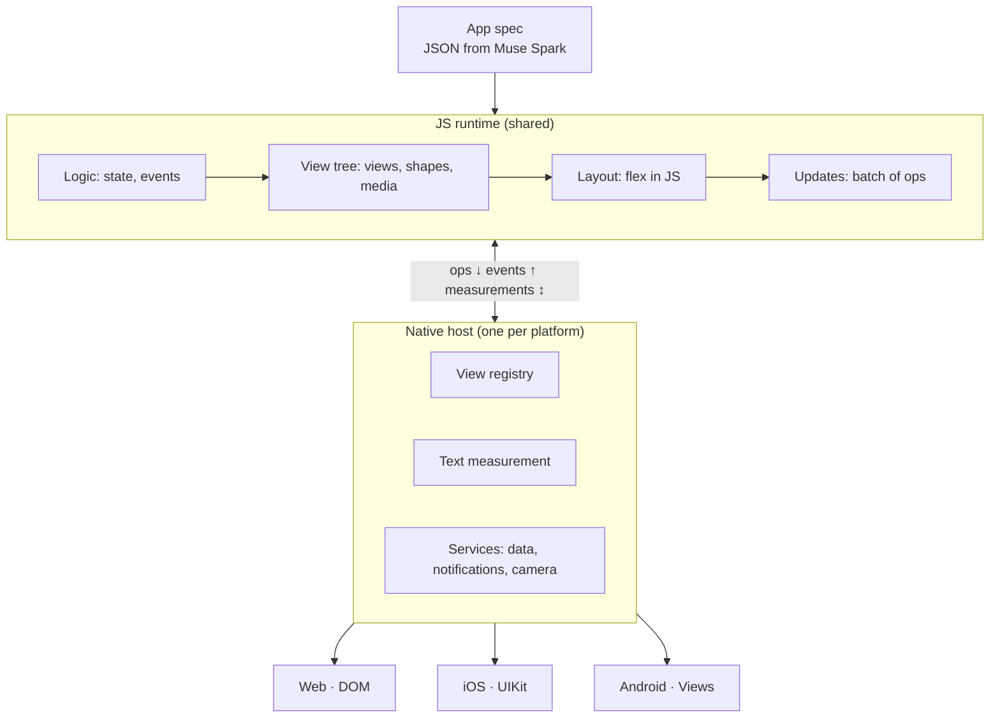

# Jig

> Describe an app, get a native one in seconds, with storage, reminders and a shared data layer built in. Muse Spark composes it from trusted components: no code to debug, nothing to deploy.

In a workshop, a jig is a tool you build for one specific job. **Jig** is one canvas for the small personal tools you describe in words.

Built for the [Meta Global AI Developer Hackathon](https://cerebralvalley.ai/e/meta-ai-developer-hackathon) (Oct 26 – Nov 4, 2026), Indie track, theme "Build for Your World".

## The problem

Everyone has needs that no app in the store fits exactly: a medication log for a parent, a kid's chore chart, a tracker for one oddly specific habit. Vibe-coding tools can generate such apps, but you get loose code: it breaks on the next edit, does nothing while closed, and keeps its data to itself.

## The idea: every app is data, not code

- You describe what you need, and **Muse Spark** composes a declarative spec: screens, components, a data schema and actions.
- The spec is validated against a schema, and the container renders it with each platform's native components. This is backend-driven UI, with the model as the backend.
- An app can't run arbitrary code, and edits apply instantly.
- Every app gets the container's services for free: storage, background jobs, notifications and a shared personal data store (with the user's permission).

Generating an app is the easy part; what only a container can offer is a **data store shared between apps** and **apps that keep acting while closed** (reminders, scheduled check-ins).

### How it differs from related work

- **[A2UI](https://a2ui.org/introduction/what-is-a2ui/)** standardizes "UI as data from a trusted component catalog". Jig shares that premise; its novelty is what sits on top of the rendering: per-app typed data, a shared data layer, background jobs, and a model loop that generates, edits and repairs specs.
- **Meta Pocket**, **GitHub Spark** and assistant canvases generate small apps, but as code on a managed runtime or a web view. Jig apps are specs rendered natively, so they can't break on edit and they share one data layer.

## Meta models

| Model | Role |
| --- | --- |
| **Muse Spark** | Generates and edits specs with structured outputs, and repairs specs that fail validation. |
| **Muse Image** | Draws app icons. |
| **SAM 3.1** | Segments and counts objects in photos, e.g. a photo of a pantry shelf becomes an inventory. |

The Meta Model API is OpenAI-SDK compatible: only the key and base URL change.

## Repository

| Path | What |
| --- | --- |
| `core/` | The shared runtime in TypeScript: spec, expressions, signals, view tree, flex layout, bridge ops. Bundles to one file (`core/dist/jig-core.js`) for the web, JavaScriptCore (iOS) and QuickJS (Android). `core/native/host.js` is the glue both native hosts share. |
| `web/` | The web host (DOM renderer and text measurement) and the playground: demo apps, live spec editing, ops and frame inspector. |
| `specs/` | Demo app specs (water tracker, chore chart, medication log) and `showcase.json`, a parity check that uses every primitive. Also used as test fixtures. |
| `ios/` | The UIKit host: runs `jig-core.js` in JavaScriptCore and applies its ops to UIKit views. |
| `android/` | The Android host: runs `jig-core.js` in QuickJS and applies its ops to Android Views. |

```bash
npm install
npm run dev      # playground at http://localhost:5173
npm test         # core tests in Node with a fake measurer
npm run build    # core bundle + web build
npm run build:native   # core bundle, native glue and demo specs copied into the iOS and Android apps
```

The iOS and Android apps load `jig-core.js` and the demo specs from their bundles, so run `npm run build:native` before building them (and after changing `core/` or `specs/`). Then open `ios/Jig/Jig.xcodeproj` in Xcode, or build `android/Jig` with Gradle.

## Architecture

All logic lives in JS; each native host is a thin renderer. React Native and Lynx work the same way.



### The loop

Native sends an event → actions update state → bindings update specific nodes (a diff only for conditionals and lists) → incremental layout → native receives one batch of ops with frames.

### Spec format

A spec has `data` (typed and persisted), `state` (transient UI state), `screens`, optional `components` and a `theme`. Each node is `{type, style, children, ...props}`. Strings may contain `{{expr}}` bindings in a small, safe JS-like expression language: no assignment, no method calls, no prototype access, only built-in functions (`filter`, `count`, `sum`, `sort`, `formatDate`, `addDays`, `arc`, ...).

```json
{
  "type": "row", "each": "chores", "as": "chore",
  "onTap": { "toggle": "chore.done" },
  "children": [
    { "type": "check", "checked": "{{chore.done}}" },
    { "type": "text", "value": "{{chore.name}}", "style": { "grow": 1 } }
  ]
}
```

- **Primitives:** `column`, `row`, `overlay`, `scroll`, `text`, `button`, `textfield`, `toggle`, `shape`, `image`, `spacer`, `divider`.
- **Built-in composites** (written in the spec format itself): `card`, `progress`, `ring`, `check`.
- **Structure:** `if`, `each` / `as` / `key`, `bind` for two-way control values.
- **Actions:** `set`, `toggle`, `push`, `remove`, `navigate` (with params), `back`, `if` / `then` / `else`. Actions run in order, and each sees the state the previous one wrote.
- **Motion:**
  - `navigate` slides the new screen in from the right, and `back` slides it out; `"transition": "fade"` or `"none"` changes that per navigation. The iOS edge swipe and Android's predictive back gesture are interactive: the screen follows the finger over a snapshot of the previous one, and pops or springs back on release.
  - `style.transition` (milliseconds, or `{"duration", "easing"}` with `ease`, `linear`, `easeIn`, `easeOut` or `spring`) animates a node between values: its frame, opacity, colors and shape trim. A node that appears in an existing list fades in, and one that is removed fades out while its siblings move into its place.
  - Shapes take `trimStart` and `trimEnd` (0–1) to draw part of their stroke, which is how `ring` sweeps smoothly. `ring` and `progress` animate by default (`"animate": false` turns it off).
  - Hosts skip animations when the system asks for reduced motion.
- **Design tokens:** theme colors (`accent`, `muted`, `surface`, ...) and type variants (`largeTitle`, `title`, `headline`, `body`, `callout`, `caption`) are resolved in the core, so every platform renders the same numbers. Each token has a dark value; hosts follow the system appearance with `runtime.setColorScheme`, and a spec can override either set (`theme`, `darkTheme`).

### Storage

App `data` lives in SQLite, in one database per device shared by every app, so the shared data store can query across apps later. The runtime owns the schema (`core/src/store.ts`); each host only runs SQL through a synchronous `db.query(sql, params)` / `db.exec(statements)` pair (system SQLite on iOS and Android, SQLite compiled to wasm on the web, stored in `localStorage`).

- A scalar or object key is one row in `jig_values`. A list is one row per item in `jig_items`, keyed by the item's `id` (or its position when it has none), with the item as JSON text, so `json_extract` can query it.
- Updates are immutable, so after each frame the runtime writes only the items whose references changed, in one transaction. Adding a chore writes one row.
- `runtime.resetData()` deletes an app's rows and starts it again from the spec defaults.

### Node kinds

- **Native views** (text, button, text field, toggle) become real platform widgets, so accessibility and text input come for free.
- **Shapes:** a single shape node with a path in SVG path syntax, fill and stroke, drawn by SVG on the web and `CAShapeLayer` on iOS. Named paths such as `@star` and `@pill` ship with the runtime.
- **Media** (image; video and audio later) are handles: JS holds an id and a source, native loads the file and reports its natural size, which triggers a relayout.
- **Containers:** row and column stacks, overlay, scroll, and absolute positioning.

### Layout

Our own flex subset in plain JS: direction, gap, padding, margin, alignment, justify, grow and shrink, fixed and percentage sizes, min/max, aspect ratio, absolute positioning. The model generates CSS-style names reliably.

- The engine talks to the host only through a measure callback, so it runs and is tested in Node with a fake measurer.
- It is incremental: every node caches measurements by constraint, dirty flags propagate to ancestors, and a final pass skips any clean subtree whose constraints didn't change (as in Yoga).
- JS is enough for hundreds of nodes. If performance becomes a problem, the core can move to C++ behind the same interface.

### Measurement

JS doesn't know how wide a string is, so hosts implement a synchronous `measureText(text, style, maxWidth) → {width, height}`, and the runtime caches results by text, style and width. Controls with an intrinsic size (toggle, text field) are sized in the core. Each host renders with its platform's system font (SF on Apple platforms, Roboto on Android, `system-ui` on the web) and measures with the same font it draws with, so layout is exact on each platform; line breaks can differ slightly between platforms.

### Bridge

Native stays "dumb". It receives one batch of ops per frame:

```js
[["create", 7, "text", {value: "Drink water"}],
 ["insert", 3, 7, 0],
 ["frame", 7, 16, 120, 343, 22]]
```

- Ops: `create`, `update`, `insert` (also moves), `remove` (destroys the subtree), `frame`, `command`. Only frames that actually changed are sent.
- Animation stays native: a value transition travels as a style prop, and the host animates the node's next frame and style changes itself. A screen change adds a `transition` command to the batch; the host snapshots the old screen before applying the ops and animates the new one in over the snapshot, so the runtime never keeps two screens alive.
- Events come back with the node id: `runtime.dispatch(id, "tap" | "change" | "submit" | "load", payload)`.
- Native keeps scroll physics, animations (JS describes a transition, native animates it), and text input: while the user types, native stays the source of truth and the runtime never echoes the value back, so the cursor doesn't jump.
- The contract is in [`core/src/bridge.ts`](core/src/bridge.ts).

### JS engine

- Web: the browser itself.
- iOS: JavaScriptCore (built into the system) on its own serial queue. Text is measured right on that queue (TextKit measurement is thread-safe), each frame's ops hop to the main thread as one JSON string, and events hop back. UIKit sets frames directly; SwiftUI would fight an external layout.
- Android: QuickJS ([quickjs-wrapper](https://github.com/HarlonWang/quickjs-wrapper)) on its own thread, with the same split as iOS: text measured with StaticLayout on the JS thread, ops to the main thread. Views are positioned by a custom `JigLayout` that only enforces the JS frames.

### Security

The runtime is our own trusted JS. An app is a JSON spec with simple expressions for bindings and actions, so the "no arbitrary code" claim holds. If model-written scripts are ever allowed, they should run in a separate QuickJS context with memory and time limits.

### Custom controls

1. **Composition from primitives** (the main path): shapes, text and taps. A progress ring is two shape arcs, a rating is five stars with `onTap`. Such a control works on every platform right away, and the model can describe it directly in the spec. `ring`, `progress` and `check` are built this way.
2. **A native component in the registry**, when primitives aren't enough (a map, a camera preview, a rich text editor): one implementation per platform, registered with its props, events and measurement.

Continuous gestures (sliders, drag) will use declarative bindings, where native moves the thumb itself and JS receives the final value, as Reanimated does in React Native. Accessibility props (`role`, `label`, `value`, increment/decrement) map to UIAccessibility on iOS and ARIA on the web.

### Performance

Built in from the start:
- Targeted updates through signals instead of a tree diff.
- Incremental layout with dirty flags and a measurement cache.
- Only changed frames go over the bridge.
- Timers for each phase of the loop (bindings, layout, measurement, apply), shown in the playground's Frame tab.

After profiling, if needed:
- A binary bridge: frames in a `Float32Array`, ops as numeric codes, strings stored once in a table.
- Batched measurement before layout.
- A native view pool by type, and virtualization for long lists.
- Hermes or QuickJS bytecode for faster startup (JavaScriptCore runs without JIT inside an iOS app).
- One runtime shared by all mini apps, and a cache of the last frame on disk so an app opens instantly.
- Long term: if every host bundled one font, JS could break lines itself from a glyph width table, with native measurement only for emoji and complex scripts.

## Status

### Core
- [x] Spec format: screens, components, data schema, actions
- [ ] JSON Schema for spec validation
- [x] JS runtime: state, bindings with targeted updates, keyed list diffing, batched ops
- [x] Flex layout in JS: measure interface, dirty flags, measurement cache
- [x] Loop phase timers for profiling
- [x] Web host (DOM) and playground with live spec editing
- [x] iOS host (UIKit + JavaScriptCore): views, text measurement, SVG shapes, images, events, storage, keyboard avoidance, back swipe, dark mode
- [x] Android host (Android Views + QuickJS): same feature set as iOS, with system back
- [x] Per-app storage in SQLite (row per list item, incremental writes)
- [ ] Spec generation from a description (Muse Spark, structured outputs)
- [ ] Edit loop by prompt: changes apply instantly
- [ ] Automatic repair of invalid specs

### Container services
- [ ] Scheduler and background jobs
- [ ] Notifications and reminders
- [ ] Shared personal data store with permissions between apps
- [ ] Camera input with SAM 3.1
- [ ] Icons with Muse Image

### Demo apps
- [x] Water tracker
- [x] Kid's chore chart
- [x] Medication log for a parent
- [ ] Workout log that feeds a meal planner (shared data store demo)
- [ ] Pantry inventory from a shelf photo (SAM demo)

## Plan

- **Days 1–3:** spec format, renderer, data layer, iOS host
- **Days 4–6:** generation and edit loop with validation and repair
- **Days 7–8:** scheduler, notifications, camera input
- **Days 9–10:** final demo apps and the demo
